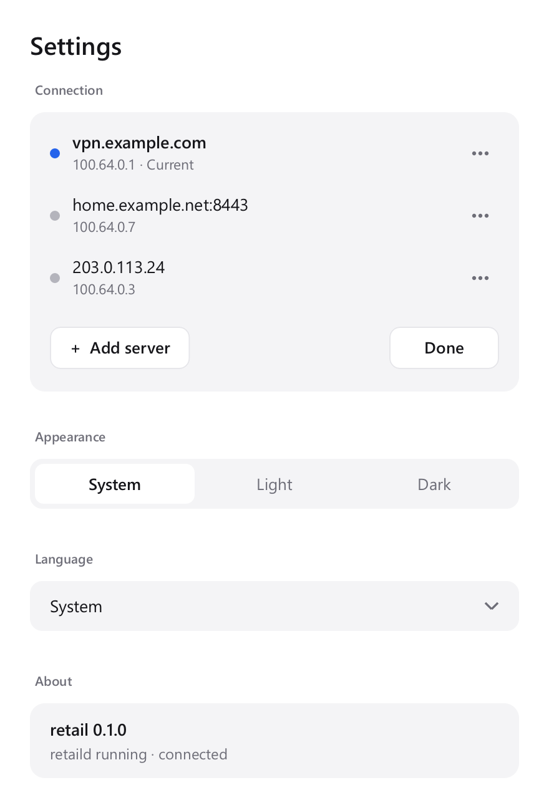

# retail

[](https://github.com/r2adkr/retail/actions/workflows/ci.yml)
[](LICENSE)

A self-hosted mesh VPN. Your devices reach each other directly over WireGuard, from any network, through a server you run yourself: on one of your own devices or on a small VPS.

| Tray | Server window | Saved servers |
|---|---|---|
|  |  |  |

## Features

- **Direct connections** through NATs (STUN and hole punching, IPv4 and IPv6), with an automatic relay over HTTPS when no direct path exists.
- **Gets through restrictive networks**: blocked UDP, TLS-inspecting firewalls, company proxies (with Windows sign-in), CDNs, NAT64, and REALITY camouflage.
- **No separate server to install**: any device hosts the network from the tray app. Invite others with a code, a QR code, or an installer that joins on its own.
- **Works behind CGNAT** with a helper node: any member device that other networks can reach, or a VPS.
- **MagicDNS**: reach devices by name, such as `nas.retail.internal`.
- **Access control** with device tags and rules.
- **Subnet routes**: reach a whole LAN (printers, NAS, cameras) through one device in it.
- **Lost devices** are cut off with one click; device keys can expire, and devices gone for long are cleaned up.
- **Encrypted server backups** to restore or move the server; devices keep their addresses and names.
- **Exit nodes**, several saved networks per device, and automatic updates.
- **Small and fast**: about 12 MB of memory, faster than wireguard-go in our [measurements](docs/DESIGN.md), and builds for Raspberry Pi and other ARM machines.
- Desktop app for Windows, macOS (Apple silicon and Intel) and Linux in English, Korean, Japanese, Chinese and Spanish, plus a CLI and a terminal UI.

## Install

Download the installer for your system from [Releases](https://github.com/r2adkr/retail/releases). It is one file that installs everything: the daemon `retaild` (runs as administrator/root, and is the server when the device hosts), the tray / menu bar app, and the `retail` CLI with `retail tui`.

| System | Installer |
|---|---|
| Windows | `retail-windows-x86_64.exe` |
| macOS (Apple silicon and Intel) | `retail-macos.zip`: open it, then open `retail.app` |
| Linux | `retail-linux-x86_64` |
| Linux on 64-bit ARM (Raspberry Pi 3/4/5) | `retail-linux-aarch64` |
| Linux on 32-bit ARM (Raspberry Pi OS 32-bit, routers) | `retail-linux-arm` |

Run it and confirm; it asks for administrator rights once. On Linux: `chmod +x retail-linux-* && sudo ./retail-linux-*`. The installers are not code-signed yet, so Windows asks to confirm (**More info → Run anyway**) and macOS wants **right-click → Open** the first time. Running a newer installer over an installed retail updates it, though installed devices also update themselves.

**Joining**: after installing, paste an invite code in the tray app. Or use an installer from your network's server, which also joins: on the server, create an invite and save the installer for the other person's system from its ⋯ menu (in the server window or the web admin page).

**Server without a screen** (Linux VPS, Raspberry Pi):

```sh
chmod +x retail-linux-x86_64 && sudo ./retail-linux-x86_64 --yes
sudo retaild install --server
```

The first command installs retail and starts it at boot; the second starts a server and prints the first invite. Or run the server image:

```sh
docker run -d -p 443:443 -p 80:80 -p 3478:3478/udp -v retail-data:/data ghcr.io/r2adkr/retail
```

See [Self-hosting](docs/SELF-HOSTING.md) for both.

## Quick start

On the device that will be the server, in the tray app: **⚙ → Manage server → Open server**, then **Create invite**. Or:

```sh
retail server start
retail server invite
```

On the other devices, paste the code in **⚙ → Settings** and click **Connect**. Or:

```sh
retail up --invite retail1.…
retail status            # devices, paths and names
retail tui               # the same in a terminal UI
```

Then, for example:

```sh
retail set --exit-node <device>                                       # send internet traffic through another device
retail server acl allow --from '*' --to tag:server --ports tcp:443    # access rules
retail server helper-device <device>                                  # helper node behind CGNAT
retail set --advertise-routes 192.168.1.0/24                          # route this LAN (then: retail server routes <device>)
retail server backup retail-server.retail-backup                      # encrypted backup of the server
retail server web                                                     # open the web admin page
```

`retail --help` lists every command. Commands that change things need the local API token: on Windows any signed-in user, on Linux root or the `retail` group, on macOS administrators.

## Documentation

- [Self-hosting](docs/SELF-HOSTING.md): servers, helper nodes, CDN and REALITY, access rules, subnet routes, backups, updates
- [Design](docs/DESIGN.md): how it works, security model, performance, known limitations
- [Development](docs/DEVELOPMENT.md): building, tests, releases

## Notes

- retail uses the `100.64.0.0/10` address range. Do not run it on a device together with another VPN that uses that range.
- The programs are not code-signed yet, so Windows SmartScreen and macOS Gatekeeper may warn on first launch. There are no mobile apps yet.

## Contributing

Contributions are welcome, big or small: bug reports, testing on networks and devices we haven't tried, translations, docs and code. Open an [issue](https://github.com/r2adkr/retail/issues) to report a problem or discuss an idea, or send a pull request. [Development](docs/DEVELOPMENT.md) explains how to build and test.

## License

[Apache-2.0](LICENSE). The vendored [boringtun](vendor/boringtun) is BSD-3-Clause.
